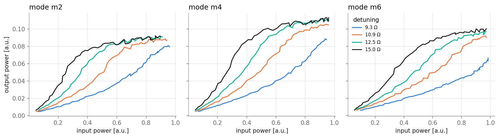
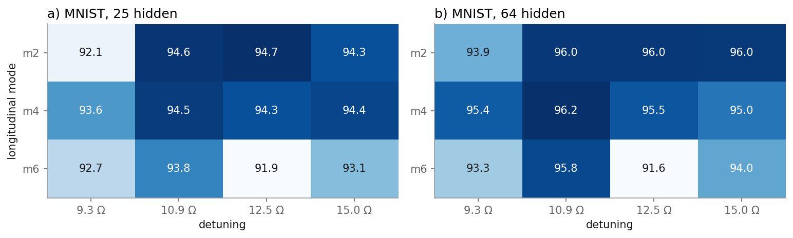
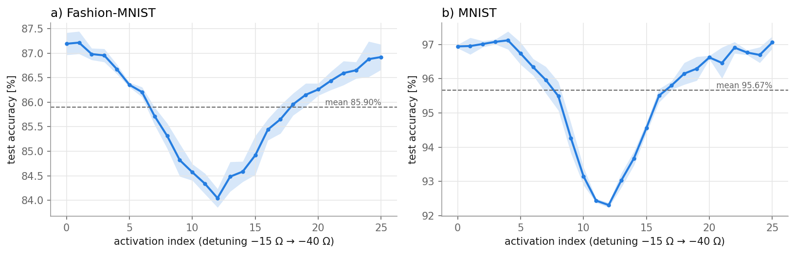
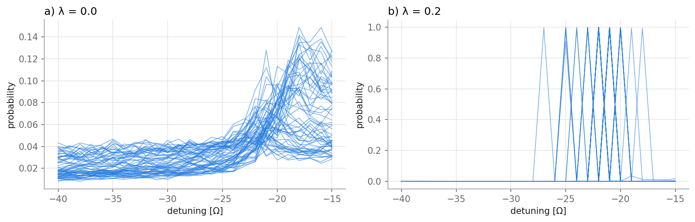
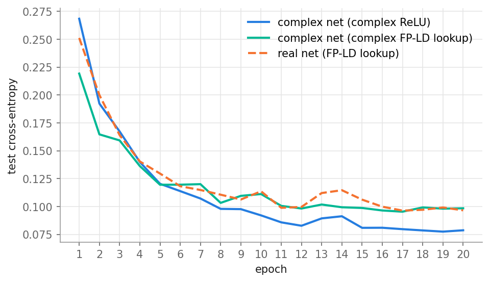

# Optical neural networks with a reconfigurable all-optical activation function

Code for my Bachelor's thesis *"Realization and Characterization of Multi-Layer Neural Networks Based on a Reconfigurable All-Optical Activation Unit"* (Strahinja Nikolić, School of Electrical Engineering, University of Belgrade, 2024; supervisor Prof. Marko Krstić).

The thesis studies how the nonlinear transfer function of an **injection-locked Fabry–Perot laser diode (FP-LD) in its bistable regime** [Crnjanski et al., *Opt. Lett.* 46, 2021; 49, 2024] can serve as the activation function of an optical neural network. The shape of the activation is reconfigured by the frequency **detuning** of the injected light. Three approaches are compared on MNIST and Fashion-MNIST:

1. **Fixed lookup-table activations.** Measured FP-LD curves are used directly as activations, with differentiable piecewise-linear interpolation.
2. **Learnable activations.** Each neuron learns a softmax distribution over the curves of a lookup table, and an **entropy penalty** forces it to pick exactly one curve, the only kind of activation the hardware can realise. The cost is 64 × 26 extra parameters.
3. **Complex-valued networks.** The FP-LD changes the *phase* of the light as well as its power, so |z| goes through the power curve and arg z through the phase curve.

The network is the same throughout: 784 → 64 → FP-LD activation → 10. It is trained with Adam (lr 1e-3, batch 64) and cross-entropy.

## Key results

All numbers are test accuracy in %. "Reproduced" values come from this repository and are averaged over 3 seeds.

**Table 3.2: all approaches**

| Network | MNIST (thesis) | MNIST (reproduced) | Fashion (thesis) | Fashion (reproduced) |
|---|---|---|---|---|
| Lookup, measured curves (mean of 12) | 94.87 | 94.89 | 85.65 | 85.08 |
| Lookup, simulated curves (mean of 26) | 95.63 | 95.67 | 85.80 | 85.90 |
| **Learnable lookup (λ = 0.2)** | **96.62** | **96.51** | **86.50** | **86.20** |
| Complex lookup (−10 Ω) | 96.20 | 96.09 | 85.62 | 85.91 |
| Complex ReLU (not realisable in hardware) | 96.37 | 96.56 | 86.74 | 86.54 |

Learning the activation does better than the average fixed activation on both datasets. It reaches nearly the best single fixed curve without searching over curves, and it uses only activations the hardware can realise.

**Table 3.1: the entropy penalty (Fashion-MNIST)**

"Soft" uses the softmax mixture of curves the network was trained with. "Argmax" uses only the most probable curve per neuron, which is what would be deployed in hardware.

| λ | soft (thesis) | soft (reproduced) | argmax (thesis) | argmax (reproduced) |
|---|---|---|---|---|
| 0.0 | 86.47 | 86.35 ± 0.28 | 85.79 | 85.40 ± 0.64 |
| 0.1 | 86.22 | 86.06 ± 0.14 | 86.21 | 85.96 ± 0.12 |
| 0.15 | 86.45 | 85.97 ± 0.20 | 86.46 | 85.95 ± 0.19 |
| 0.2 | 86.50 | 86.20 ± 0.34 | 86.50 | 86.20 ± 0.34 |

Without the penalty the learned distributions are almost flat, and switching to the argmax curve at test time costs accuracy. With λ ≥ 0.1 every neuron settles on a single curve, so the soft and argmax accuracies are the same. The original checkpoints of this table are not part of this repo, but evaluating them with this code reproduces the thesis numbers exactly.

### Figures (reproduced)

**The activation functions.** The 12 measured FP-LD curves (Fig. 2.1):


**How much the choice of activation matters.** MNIST accuracy for each measured curve, with 25 and 64 hidden neurons (Fig. 3.1). The best and worst curve differ by 2.7% and 4.6% (thesis: 2.9% and 4.6%).


Each of the 26 simulated lookup-table curves used as a fixed activation (Fig. 3.3). Accuracy forms a V-shape over detuning, with its minimum around −26 Ω.


**The learned activation distributions** for all 64 neurons (Fig. 3.4). With the entropy penalty (b), each neuron puts all its probability on one curve.


**Real vs. complex networks.** MNIST test loss over 20 epochs (Fig. 3.5).


The other figures (Fig. 2.2 lookup surface, Fig. 2.3 complex activations, Fig. 3.2 Fashion heatmap) are in [figures/](figures/).

## How to run

```bash
python3 -m venv .venv && source .venv/bin/activate
pip install -r requirements.txt

jupyter notebook reproduce.ipynb        # every figure and table, loaded from results/
```

The notebook reads the cached results in [results/](results/). To retrain from scratch:

```bash
python -m onn.experiments --list                     # available experiments
python -m onn.experiments all --force --jobs 5       # everything: ~15 min on a laptop CPU
python -m onn.experiments fig3_3_mnist --force       # a single experiment
python -m onn.experiments all --force --seeds 5      # more seeds
```

MNIST and Fashion-MNIST are downloaded to `data/` on first use. No GPU is needed, because the whole dataset is kept in memory and one epoch takes under a second.

## Repository layout

```
onn/
  activations.py   lookup / learnable / complex FP-LD activations + interpolation
  models.py        MLP, LearnableMLP, ComplexLinear, ComplexMLP
  data.py          in-memory MNIST/Fashion-MNIST, loaders for the FP-LD data
  training.py      train / evaluate loops (entropy penalty for learnable nets)
  experiments.py   one function per thesis experiment, cached to results/*.json (CLI)
  plotting.py      thesis figures
  report.py        Tables 3.1 / 3.2 next to the values printed in the thesis
reproduce.ipynb    the notebook that reproduces Chapter 3
assets/            FP-LD data: 12 measured curves (fpld_mode{2,4,6}.mat),
                   simulated 2D lookup table (fpld_2d_lookup.mat),
                   simulated power+phase curves (fpld_complex.mat)
results/           cached experiment outputs (JSON)
figures/           figures written by the notebook
```

## References

- J. Crnjanski, M. Krstić, A. Totović, N. Pleros, D. Gvozdić, "Adaptive sigmoid-like and PReLU activation functions for all-optical perceptron," *Opt. Lett.* 46, 2003–2006 (2021).
- J. Crnjanski, I. Teofilović, M. Krstić, D. Gvozdić, "Application of a reconfigurable all-optical activation unit based on optical injection into a bistable Fabry–Perot laser in multilayer perceptron neural networks," *Opt. Lett.* 49, 1153–1156 (2024).
- M. Goyal, R. Goyal, B. Lall, "Learning Activation Functions: A new paradigm for understanding Neural Networks" (2020).
